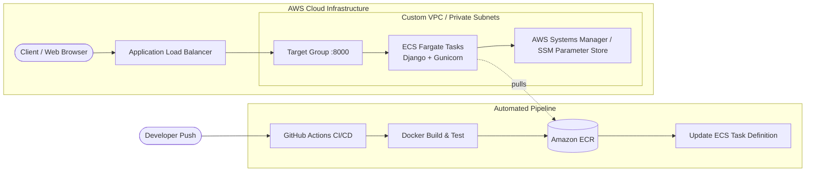

# Deploy Dockerized Django on AWS ECS Fargate with Terraform & GitHub Actions

An enterprise infrastructure-as-code and CI/CD blueprint for deploying containerized **Django** applications to **AWS ECS (Elastic Container Service) Fargate** using **Terraform**, **Amazon ECR**, **Application Load Balancers (ALB)**, and **GitHub Actions**.

[](https://github.com/codewithmuh/django-aws-ecs-terraform/releases)
[](https://github.com/codewithmuh/django-aws-ecs-terraform/stargazers)
[](https://github.com/codewithmuh/django-aws-ecs-terraform/network/members)
[](LICENSE)
[](https://terraform.io)
[](https://aws.amazon.com/ecs)
[](https://docker.com)
[](https://youtube.com/@codewithmuh)
[](https://www.linkedin.com/in/muhammadrashid-daha/)

📺 **Full YouTube Video Tutorial:** https://youtu.be/o22qYKDCGbU


---

## 📑 Table of Contents
- [Architecture & Request Flow](#architecture--request-flow)
- [Repository Structure](#repository-structure)
- [Prerequisites](#prerequisites)
- [Step 1: Provision Infrastructure with Terraform](#step-1-provision-infrastructure-with-terraform)
- [Step 2: Setup GitHub Actions CI/CD Pipeline](#step-2-setup-github-actions-cicd-pipeline)
- [Step 3: Verification & Load Balancer Testing](#step-3-verification--load-balancer-testing)
- [Cleanup](#cleanup)
- [Author & Community](#author)
- [License](#license)

---

## 🏛️ Architecture & Request Flow



---

## 📂 Repository Structure

```
django-aws-ecs-terraform/
├── django/                        # Application source code
│   ├── Dockerfile                 # Multi-stage production container build
│   ├── requirements.txt           # Python dependencies (Django, Gunicorn, psycopg2)
│   ├── manage.py
│   └── project/                   # Django settings and WSGI configuration
├── terraform/                     # Infrastructure as Code
│   ├── main.tf                    # Root orchestration
│   ├── provider.tf                # AWS provider definition
│   ├── variables.tf               # Configurable region, VPC, and cluster params
│   ├── modules/                   # Reusable Terraform modules
│   │   ├── vpc/                   # Public & private subnets, NAT Gateway, Route Tables
│   │   ├── ecs/                   # ECS Cluster, Task Definition, Fargate Service
│   │   ├── alb/                   # Application Load Balancer & Target Groups
│   │   └── security-groups/       # Ingress / Egress firewall rules
└── .github/workflows/
    └── aws-ecs.yml                # CI/CD pipeline building, pushing & deploying
```

---

## 🛡️ Prerequisites

- An active **AWS Account** with permissions for IAM, VPC, ECS, ECR, and ALB.
- **Terraform ≥ 1.0** installed locally.
- **AWS CLI v2** configured (`aws configure`).
- Docker installed locally for local testing.

---

## 🚀 Step-by-Step Deployment Guide

### Step 1: Provision Infrastructure with Terraform

1. Navigate to the terraform directory:
   ```bash
   cd terraform
   ```

2. Initialize Terraform providers and backend:
   ```bash
   terraform init
   ```

3. Review the planned AWS resources:
   ```bash
   terraform plan
   ```

4. Apply the configuration:
   ```bash
   terraform apply --auto-approve
   ```

Outputs will display your **Amazon ECR repository URI** and the **Application Load Balancer DNS Name**.

---

### Step 2: Setup GitHub Actions CI/CD Pipeline

In your GitHub repository settings, navigate to **Settings → Secrets and variables → Actions** and add the following repository secrets:

| Secret Name | Value Description |
| :--- | :--- |
| `AWS_ACCESS_KEY_ID` | IAM User access key with ECR and ECS deployment permissions |
| `AWS_SECRET_ACCESS_KEY` | IAM User secret key |
| `AWS_REGION` | Your deployment AWS region (e.g. `us-east-1`) |
| `ECR_REPOSITORY` | Name of your ECR repository provisioned by Terraform |
| `ECS_SERVICE` | Name of the ECS Fargate service |
| `ECS_CLUSTER` | Name of the ECS cluster |
| `ECS_TASK_DEFINITION` | Path to task definition JSON or registered family name |

Every `git push` to `main` will build the Docker container, push the image to ECR, and trigger a rolling zero-downtime deployment on AWS ECS Fargate!

---

### Step 3: Verification & Load Balancer Testing

Once the deployment pipeline succeeds:
1. Copy the ALB DNS Name from Terraform outputs or AWS Console:
   ```bash
   curl http://<ALB-DNS-NAME>/
   ```
2. Open `http://<ALB-DNS-NAME>/` in your browser to verify your live Django application.

---

## 🧹 Cleanup

To prevent unnecessary AWS charges when finished experimenting:

```bash
cd terraform
terraform destroy --auto-approve
```

---

## 👨‍💻 Author

**Muhammad Rashid** — DevOps & Cloud Engineer, AWS Community Builder.  
- 🎥 **YouTube:** [@codewithmuh](https://youtube.com/@codewithmuh)  
- 💼 **LinkedIn:** [Muhammad Rashid](https://www.linkedin.com/in/muhammadrashid-daha/)  
- 🌐 **Website:** [codewithmuh.com](https://codewithmuh.com) · [devopsbymuh.com](https://devopsbymuh.com)

⭐ **If you find this repository helpful, please star it on GitHub!**

---

## 📄 License

This project is licensed under the [MIT License](LICENSE).
